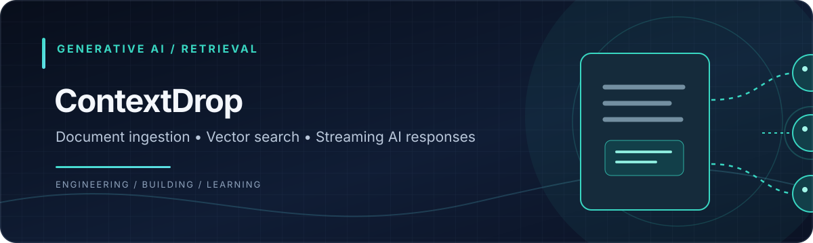
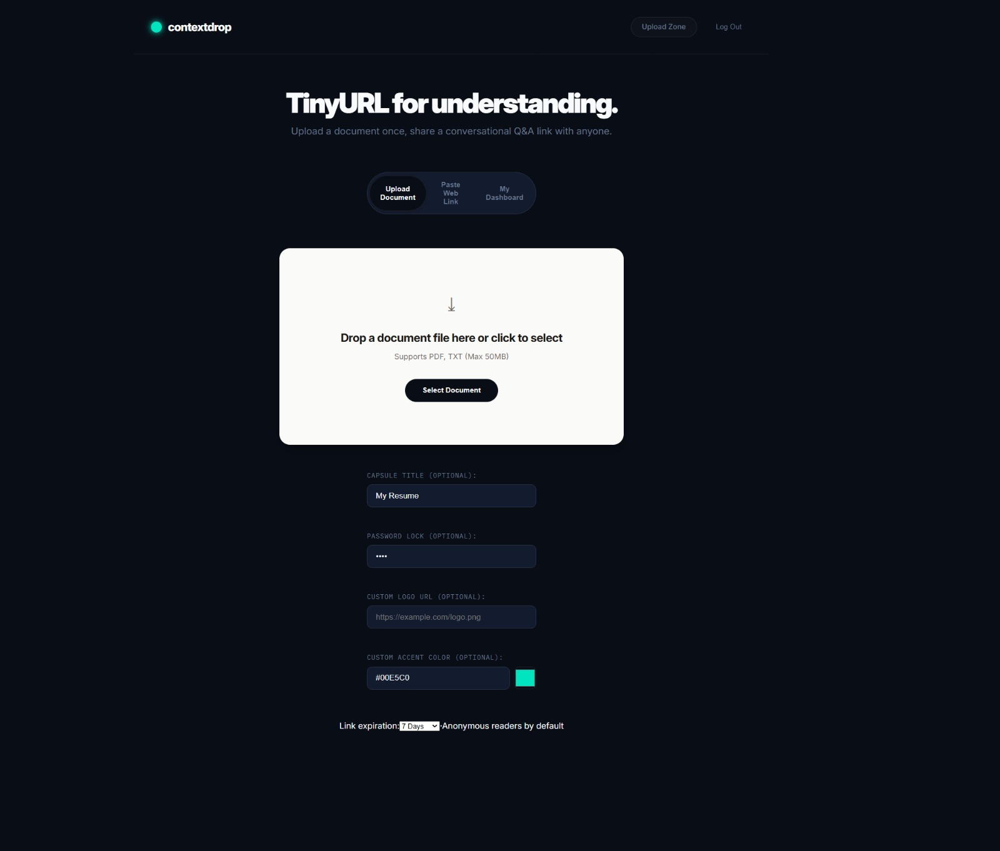
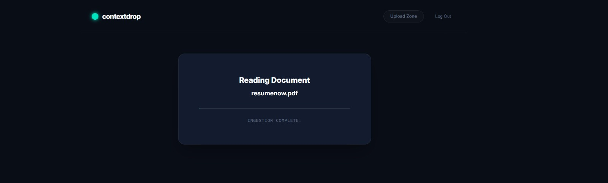
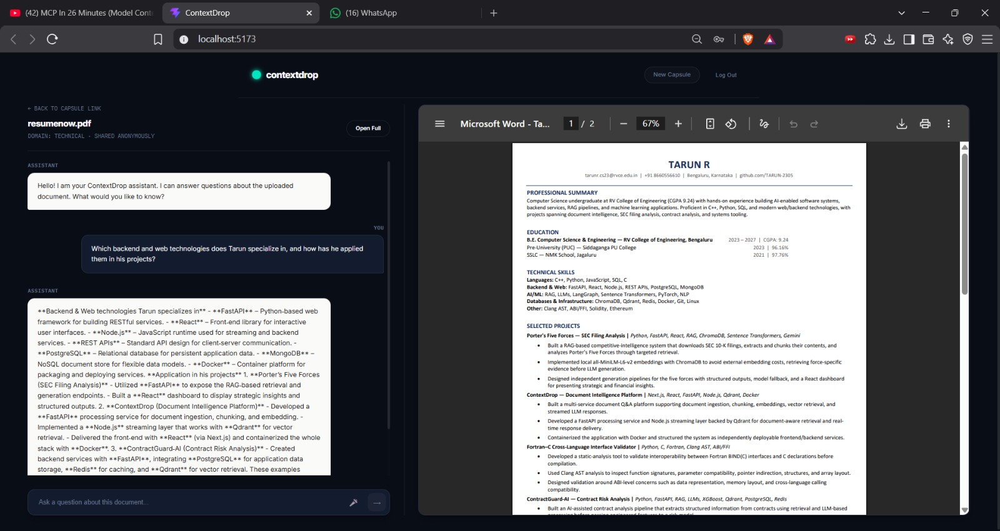
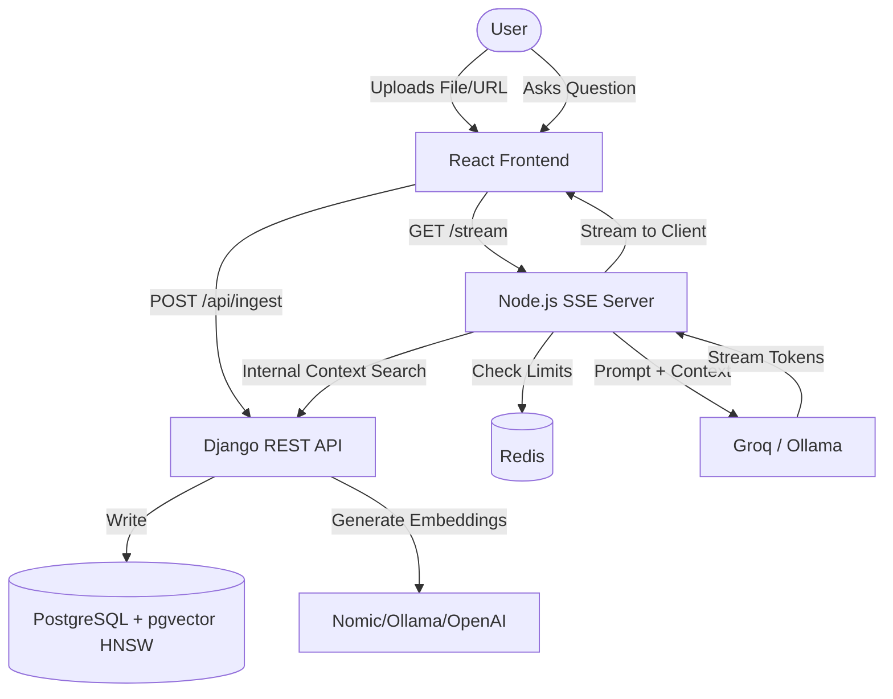

<div align="center">
  
</div>

---

# ContextDrop — Share Documents that Answer Back

> **TinyURL for understanding.** Upload a document or scrape a URL once, and share a secure conversational Q&A link with anyone.

ContextDrop transforms static documents (PDFs, TXT) and web links into interactive, conversational knowledge capsules. 
When you share a document, you create a **Capsule**. A capsule represents a sandboxed RAG (Retrieval-Augmented Generation) context. Readers click the link and immediately get a messaging-style chat interface where they can ask questions about the document, with answers grounded strictly in the provided text.

## 🚀 Features & Engineering Quality

* **Production-Ready Security**: Inter-service communication is secured via strict HMAC SHA-256 signatures and timestamp replay windows. The system also includes robust protection against SSRF attacks during URL ingestion using `ipaddress` resolution blocking (blocks loopbacks, private networks, and internal metadata endpoints).
* **Scalable Architecture**: A split-backend microservice architecture. A Django REST backend handles secure ingestion, vectorization, and Postgres HNSW indexing, while a separate Express SSE server manages high-concurrency streaming and Redis rate limiting.
* **100% Grounded AI & Observability**: AI is sandboxed to the document using HNSW pgvector semantic search. The system uses strict RAG failure handling to explicitly state when context is missing, rather than hallucinating. Complete JSON structured logging ensures full observability.
* **Evaluation Framework**: Includes an integrated evaluation dataset (`evaluation/`) calculating `Recall@K` to objectively measure retrieval performance and quality.
* **Document Ingestion with Smart Chunking**: Supports PDF, TXT, and Web URLs. Implements structure-aware text chunking (paragraph boundary detection) for superior embedding context.
* **Verification and Traceability**: Inline, clickable page citations accompany every answer.
* **Automated Domain Classification**: Zero-shot classifier detects if a document is Legal, Medical, Academic, etc., and adjusts the LLM persona.
* **Capsule Dashboard**: Creators can view analytics, query heatmaps, and a log of unanswered questions to identify gaps in their documents.
* **White-Labeling & Security**: Custom logo and accent color support, along with optional password protection for shared links.

## 📸 Screenshots






## 🎨 Tech Stack & Architecture

1. **Frontend**: React (TypeScript) + Vite, built with modular, reusable components.
2. **REST API Backend**: Django & DRF + PostgreSQL (pgvector with HNSW indexing).
3. **SSE Server**: Node.js & Express + Redis (Fail-closed rate limiting).
4. **AI Models**: 
   - Groq (`llama-3.3-70b-versatile`) for primary chat and domain classification.
   - OpenAI (`text-embedding-3-small`) or Nomic (`nomic-embed-text-v1.5`) for embeddings.
   - Ollama (`gemma4:e2b` and `nomic-embed-text`) as a local fallback for offline/free usage.



## 🛠️ Setup & Development Guide

### Prerequisites
* Docker & Docker Compose
* Python 3.10+
* Node.js 18+

### Step 1: Infrastructure (Database & Cache)
Start the required PostgreSQL (with pgvector) and Redis containers:
```bash
docker-compose up -d
```

### Step 2: Backend Setup (Django)
1. Navigate to the backend directory:
   ```bash
   cd backend
   ```
2. Create and activate a Python virtual environment:
   ```bash
   python -m venv .venv
   source .venv/bin/activate  # On Windows: .venv\Scripts\activate
   ```
3. Install dependencies:
   ```bash
   pip install -r requirements.txt
   ```
4. Copy `.env.example` to `.env` and fill in your configuration:
   ```bash
   cp .env.example .env
   ```
5. Apply migrations and start the server:
   ```bash
   python manage.py makemigrations
   python manage.py migrate
   python manage.py runserver
   ```
   *Runs on `http://localhost:8000`. Health checks available at `/api/health` and `/api/readiness`.*

### Step 3: SSE Server Setup (Node.js)
1. Navigate to the SSE server directory:
   ```bash
   cd sse-server
   ```
2. Install dependencies and start:
   ```bash
   npm install
   cp .env.example .env
   node index.js
   ```
   *Runs on `http://localhost:4000`. Health checks available at `/health` and `/readiness`.*

### Step 4: Frontend Setup (React)
1. Navigate to the frontend directory:
   ```bash
   cd frontend
   ```
2. Install dependencies and start:
   ```bash
   npm install
   npm run dev
   ```
   *Runs on `http://localhost:5173`*

## 🧪 Testing & Evaluation
- **Backend Tests**: Run `python manage.py test capsules.tests` to execute unit tests for auth, ingestion, chunking, and vector search.
- **SSE Server Tests**: Run `npm test` in the `sse-server` directory.
- **RAG Evaluation**: See `evaluation/README.md` to run the `Recall@K` metric evaluation for semantic search accuracy.
