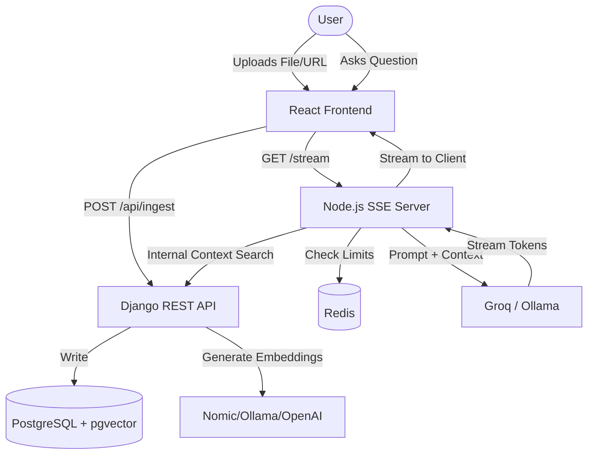

# ContextDrop — Share Documents that Answer Back

> **TinyURL for understanding.** Upload a document or scrape a URL once, and share a secure conversational Q&A link with anyone.

ContextDrop transforms static documents (PDFs, TXT) and web links into interactive, conversational knowledge capsules. 
When you share a document, you create a **Capsule**. A capsule represents a sandboxed RAG (Retrieval-Augmented Generation) context. Readers click the link and immediately get a messaging-style chat interface where they can ask questions about the document, with answers grounded strictly in the provided text.

## 🚀 Features

* **Zero-Friction Reader Access**: Readers do not need to sign up or download files. 
* **100% Grounded AI**: The AI is strictly sandboxed to the document using pgvector semantic search.
* **Verification and Traceability**: Inline, clickable page citations accompany every answer.
* **Document Ingestion**: Supports PDF, TXT, and Web URL scraping (with basic anti-bot bypass heuristics).
* **Automated Domain Classification**: Zero-shot classifier detects if a document is Legal, Medical, Academic, etc., and adjusts the LLM persona.
* **Capsule Dashboard**: Creators can view analytics, query heatmaps, and a log of unanswered questions to identify gaps in their documents.
* **White-Labeling**: Custom logo and accent color support for branded capsules.
* **Security**: Optional password protection for shared links.

## 🎨 Tech Stack & Architecture

ContextDrop uses a split-backend microservice architecture to prevent long-lived streaming connections from blocking standard API requests.

1. **Frontend**: React (TypeScript) + Vite.
2. **REST API Backend**: Django & Django REST Framework (DRF) + PostgreSQL (pgvector). Handles file parsing, chunking, embeddings, authentication, and vector search.
3. **SSE Server**: Node.js & Express + Redis. Handles high-concurrency Server-Sent Events (SSE) for streaming LLM tokens back to the client. Uses Redis for rate-limiting.
4. **AI Models**: 
   - Groq (`llama-3.3-70b-versatile`) for primary chat and domain classification.
   - OpenAI (`text-embedding-3-small`) or Nomic (`nomic-embed-text-v1.5`) for embeddings.
   - Ollama (`gemma4:e2b` and `nomic-embed-text`) as a local fallback for offline/free usage.



## 🛠️ Setup & Development Guide

### Prerequisites
* Docker & Docker Compose
* Python 3.10+
* Node.js 18+

### Step 1: Infrastructure (Database & Cache)
Start the required PostgreSQL (with pgvector) and Redis containers:
```bash
docker-compose up -d
```

### Step 2: Backend Setup (Django)
1. Navigate to the backend directory:
   ```bash
   cd backend
   ```
2. Create and activate a Python virtual environment:
   ```bash
   python -m venv .venv
   source .venv/bin/activate  # On Windows: .venv\Scripts\activate
   ```
3. Install dependencies:
   ```bash
   pip install -r requirements.txt
   ```
4. Create `.env` in `backend/contextdrop/.env` based on your API keys (Groq, OpenAI, Nomic).
5. Apply migrations and start the server:
   ```bash
   python manage.py makemigrations
   python manage.py migrate
   python manage.py runserver
   ```
   *Runs on `http://localhost:8000`*

### Step 3: SSE Server Setup (Node.js)
1. Navigate to the SSE server directory:
   ```bash
   cd sse-server
   ```
2. Install dependencies and start:
   ```bash
   npm install
   node index.js
   ```
   *Runs on `http://localhost:4000`*

### Step 4: Frontend Setup (React)
1. Navigate to the frontend directory:
   ```bash
   cd frontend
   ```
2. Install dependencies and start:
   ```bash
   npm install
   npm run dev
   ```
   *Runs on `http://localhost:5173`*

## ⚠️ Limitations & Future Improvements

- **Database Indexing**: The `pgvector` implementation currently uses exact nearest neighbor search (sequential scan) via raw SQL. For massive scale, an HNSW index should be added to the vector column.
- **SSRF Risk**: URL ingestion fetches external links. In a production environment, strict validation against resolving internal IP addresses (e.g., AWS Metadata endpoints) must be implemented.
- **Frontend Refactoring**: `App.tsx` contains the majority of the application logic and should be refactored into modular components.
- **Testing**: A comprehensive automated test suite (Pytest, Jest) is currently missing and needed before production release.
